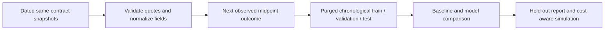

# Options Lab

A reproducible workspace for options-chain research, chronological model evaluation, and historical strategy simulation. The dashboard uses saved data; it does not submit orders.


## Start here

Use **Python 3.12**. `requirements.lock` pins the complete tested Python environment; `requirements.txt` declares the project's direct requirements. The lock was validated on Linux x86-64. LightGBM requires an OpenMP runtime; XGBoost's Linux package may also install NVIDIA runtime dependencies even though training uses the CPU.

```bash
python3.12 -m venv venv
source venv/bin/activate
make setup
make research
make dashboard
```

Open the local server in your browser. The dashboard needs no API keys, external fonts, or JavaScript build. `make research` prepares labels, runs eligible models, exports a provenance-checked dashboard, and renders figures. Run from the repository root. Windows users can run the commands from the Makefile directly.

**Current data result:** the two included source files contain 2,100 rows across June 15 and June 29, 2025. Validation retains 1,798 snapshots of 1,724 contracts. There are **zero eligible follow-up observations within the seven-day label horizon**. The pipeline correctly reports `insufficient_data`; no model scores or backtest profits are available. Some contracts recur after fourteen days, which is outside the configured target horizon. The checked-in dashboard displays this limitation instead of legacy experiment scores.

## Collect real contract histories

```bash
python -m options_lab collect --tickers SPY AAPL QQQ TSLA MSFT
```

Run on successive trading dates while the same contracts remain unexpired. Collection appends uniquely timestamped CSVs to `data/snapshots/`; existing snapshots are never overwritten. Raw source files remain unchanged. New local snapshots are ignored by Git: deliberately review and add any history you intend CI and collaborators to use, or pass a separate directory with `--input`. Retain original records and record data-source permissions before sharing them.

Live collection requires Yahoo Finance access. Collection time is recorded in UTC, but is not a guarantee of fresh exchange quotes. Live access was previously blocked in this cloud environment; offline development and all checks work without it. Do not repeatedly collect on the same day to manufacture next-day outcomes: the loader keeps only the latest observation per contract per UTC date.

## What the experiment predicts



- **Target:** whether the same contract's midpoint increases at its next observed UTC date, at most seven calendar days later. This is not expiration ITM, a fixed one-day return, or a prediction that a trade clears costs. Missing future observations stay unlabeled.
- **Data quality:** reject conflicting contract identities, missing collection/expiry dates, expired contracts, crossed quotes, nonpositive bids, and invalid liquidity fields. Deduplicate each contract/day. Report exclusions rather than silently treating bad quotes as valid.
- **Features:** current strike, midpoint, relative spread, volume, open interest, implied volatility, days to expiry, and moneyness. Target columns and future quotes are never features. Missing underlying prices are handled by training-only imputation.
- **Split:** assign entire labeled collection dates to chronological 60/20/20 train/validation/test windows. Purge training outcomes that reach validation and validation outcomes that reach test. Require at least ten labeled dates and 20/5/5 observations after purging, plus both training classes. These are minimum execution checks, not evidence that a sample is statistically adequate.
- **Models:** majority baseline, logistic regression, XGBoost, and LightGBM. Imputation and scaling fit only on training data. No synthetic oversampling is used. Fixed parameters and seeds keep the initial comparison small and repeatable.
- **Selection:** choose the lowest validation Brier loss, including the majority baseline. The strategy threshold is fixed in configuration; the test set is not used for selection or threshold tuning.
- **Evaluation:** export accuracy, balanced accuracy, Brier loss, ROC-AUC, confusion matrices, and ROC coordinates. A one-class holdout has no ROC-AUC; it is exported as `null`. Test permutation importance includes negative values and repeat variability. It describes sensitivity, not causation.

For a lighter run or your own history:

```bash
python -m options_lab research --input data/raw data/snapshots --models logistic
python -m options_lab research --input /path/to/history --output artifacts/custom --require-ready
```

`--require-ready` exits with code 2 when data is insufficient. Without it, a successful audit with insufficient data exits 0 and explicitly reports that training and backtesting were not run. Invalid input or runtime failures still fail the command. Hyperparameter tuning is intentionally excluded from this first trustworthy evaluation path.

## Backtest assumptions

`config/backtest.json` controls initial cash, allocation per position, total/per-ticker position caps, minimum volume and open interest, maximum spread, fees, slippage, probability threshold, and contract multiplier. Example:

```bash
python -m options_lab research --backtest-config config/backtest.json
```

The simulator uses held-out signals only. It buys at the current snapshot's ask plus slippage and sells at the same contract's next observed bid minus slippage, charging fees on both sides. Contracts are whole units; future proceeds cannot fund earlier entries. Open positions cannot duplicate a contract. Exits occur before entries at a shared timestamp. Allocation is based on current cash plus open cost basis, with cash and position limits enforced. Cash is reserved for closing fees.

The report includes net profit, return on initial cash, trade count, trade ledger, cash/equity events, and event-time maximum drawdown. Open positions are conservatively carried at entry bid less liquidation costs until exit. **This is not a complete daily mark-to-market drawdown.** Fills immediately after snapshot collection are an assumption, not evidence of executable prices. Fee and slippage parameters are assumptions to stress-test, not calibrated estimates.

The experiment conditions on an available usable future quote, which can cause survivorship bias. The simulator does not model exercise, assignment, financing, dividends, taxes, market impact, or broker execution. Missing observations and stale quotes limit its conclusions. This is research infrastructure, not a validated trading strategy or a paper-trading integration.

## Reports, figures, and dashboard

Default generated files live under ignored `artifacts/research/`:

| File | Contents |
| --- | --- |
| `report.json` | Status, data audit and dates, input and pipeline-source SHA-256 hashes, pipeline/library versions, split boundaries, metrics, importance, backtest assumptions and limitations |
| `labeled.csv` | Validated snapshots, contract-matched outcomes, and unlabeled rows |
| `predictions.csv` | Selected model's held-out predictions and observed execution quotes; only when ready |
| `model.joblib` | Fitted pipeline with features, target definition, version and input fingerprints; only when ready |
| `trades.csv` | Closed simulated trades, costs and P&L; only when ready |

A new run removes previous known model/prediction/report outputs before evaluating readiness, so insufficient data cannot accidentally reuse an older model. Load only trusted model artifacts with matching library versions.

`dashboard/build_data.py` checks input fingerprints, pipeline source hashes, and pipeline version before exporting `dashboard/data.js`. The explorer shows the latest usable observation for each contract, including its collection date. When ready, the dashboard displays verified model comparisons, a held-out ROC curve, permutation importance, and simulation outcomes with their assumptions. When history is insufficient, it explains the missing prerequisite. Synthetic test results are never exported to the real dashboard.

`python dashboard/render_charts.py` renders the current report under `artifacts/figures/` without retraining. Older files in `images/` and the legacy `models/` and processed CSVs belong to earlier experiments and are not inputs to the new evaluation. Do not treat their historical scores as verified results.

## Notebooks and checks

```bash
cd notebooks
jupyter lab
```

All five maintained notebooks use the shared Python pipeline. Data-preparation notebooks inspect features and labels without overwriting raw or processed CSVs. Model notebooks save their own outputs under `artifacts/`. The collector defaults to offline inspection; enable `COLLECT_LIVE` explicitly to fetch data. Inline package installs and the undefined `lgb_model` save are removed.

```bash
npm ci --ignore-scripts
npx playwright install chromium
make check
```

Checks cover contract isolation, label horizons, chronology and purging, training-only preprocessing, model serialization, real inference, stale-export rejection, quote-side costs, cash/position constraints, invalid configurations, and frontend filtering/rendering. All five notebooks execute offline. Synthetic quote fixtures exercise the complete modeling and backtest path; they test software behavior, not market performance. Browser checks cover both insufficient-data and evaluated states, including one-class ROC handling and mobile layout.

If Chromium is already installed, use `CHROMIUM_PATH=/usr/bin/chromium npm test`. The cloud environment uses that option because downloading Playwright browsers is blocked. Use `SCREENSHOT=images/dashboard.png npm test` to refresh the real dashboard screenshot.

## Continuous integration and publishing

`.github/workflows/checks.yml` installs the locked Python and Node dependencies, runs tests, audits the real data, verifies the committed dashboard export, executes notebooks, and runs browser checks. PRs and pushes to `main` or `my-first-code` run checks. An explicit `insufficient_data` report is an acceptable data-audit result; it is not reported as successful model training.

After checks pass, pushes to the development branch **`my-first-code`** stage only the static dashboard files and deploy through the official GitHub Pages actions. To activate this workflow, choose **GitHub Actions** as the source in repository **Settings → Pages → Build and deployment**. The existing site uses the `gh-pages` branch; keep that source until you are ready to activate the new workflow. A preflight check skips automatic deployment with a clear notice until the Pages source is switched, then the next push or manual workflow run activates it. No personal access token is required. The cloud session cannot change or verify this setting because GitHub API access is blocked.

Change the workflow's deployment branch condition if you later promote `main` to the publishing branch. The workflow avoids pushing a Pages commit with `GITHUB_TOKEN`, because that would not trigger a branch-based Pages rebuild. These workflow changes take effect only after they are pushed to GitHub.

## Layout

```text
options_lab/          Shared collection, data, research, backtest, and plotting code
config/backtest.json  Explicit strategy and execution assumptions
notebooks/            Five guided offline-capable research notebooks
scripts/              Collection compatibility entry point and notebook checks
index.html            Static dashboard
dashboard/           Dashboard data export, styles, and interactions
data/raw/            Included source snapshots
data/snapshots/      Append-only local collections (ignored)
artifacts/           Reproducible local outputs (ignored)
tests/               Python and browser regression checks
.github/workflows/   CI and validated GitHub Pages deployment
```
