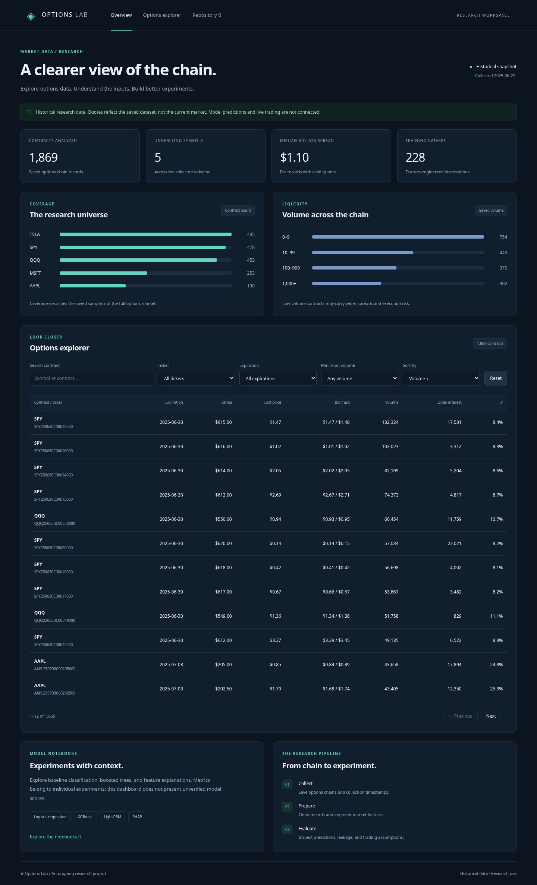
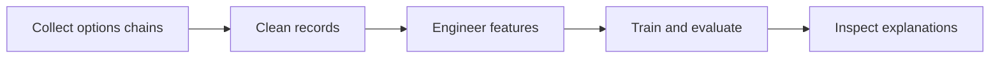
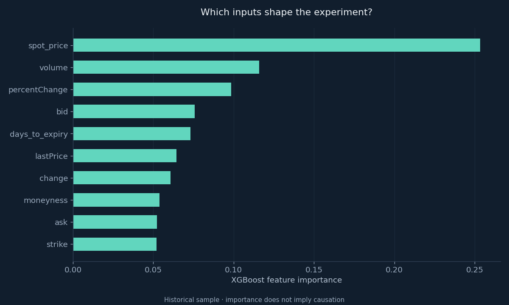
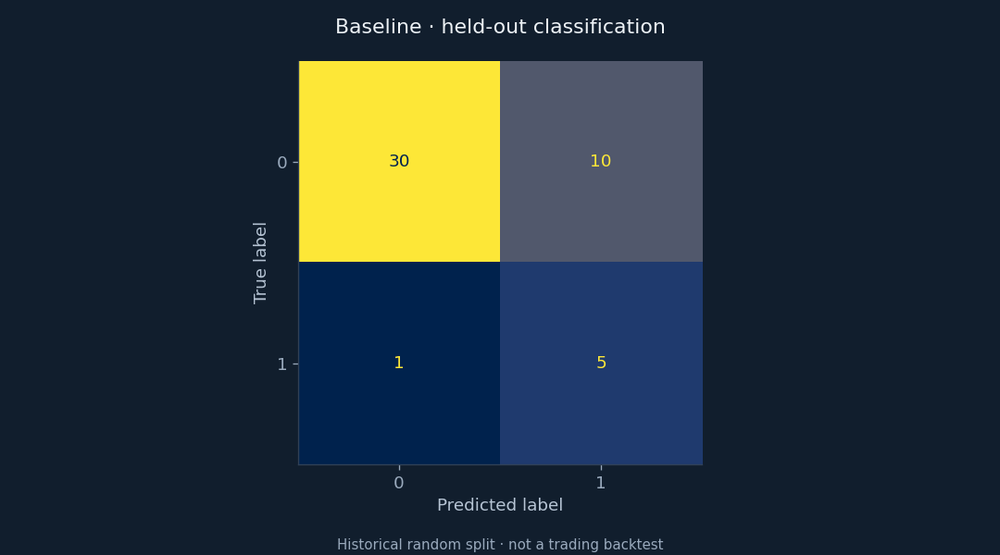

# Options Lab

A research workspace for exploring options chains, engineering features, and comparing classification models.



## Explore the dashboard

The **[dashboard](index.html)** is a static site: no build step, API keys, or external fonts are required. Serve it from the repository root:

```bash
python3 -m http.server 8080
```

Then open the local server in your browser.

The explorer includes ticker, expiration, and minimum-volume filters, contract search, sorting, and pagination. Coverage, liquidity, and spread summaries come from the checked-in dataset. Quotes are historical; the collection date is displayed in the dashboard. The interface adapts to desktop and mobile, supports keyboard navigation, and keeps numeric columns aligned for comparison.

To refresh its data after updating the CSVs:

```bash
python3 dashboard/build_data.py
```

This regenerates `dashboard/data.js` from the processed CSVs, without modifying the source data.

## Research workflow



| Notebook | Purpose |
| --- | --- |
| `multi_ticker_scraper.ipynb` | Collect and timestamp Yahoo Finance options chains |
| `clean_multi_ticker_data.ipynb` | Remove missing and duplicate records |
| `feature_engineering.ipynb` | Prepare features and exploratory targets |
| `model_baseline.ipynb` | Train and inspect a logistic regression baseline |
| `model_xgboost.ipynb` | Compare boosted trees, resampling, feature importance, and SHAP |

Run notebooks from the `notebooks/` directory so relative dataset paths resolve. Each notebook includes shared chart styling, section headings, and interpretation notes. Outputs are collapsed by default to keep the narrative readable; expand them to inspect results. Collection, preparation, and model-export cells can overwrite CSVs, images, or model artifacts—use a copy of the project for exploratory runs when you want to preserve the included snapshot.

## Python setup

Use Python 3.11 or 3.12; the pinned NumPy version requires Python 3.11 or later.

```bash
python3 -m venv venv
source venv/bin/activate
python -m pip install -r requirements.txt
python -m pip install scikit-learn seaborn xgboost lightgbm imbalanced-learn shap jupyterlab
cd notebooks
jupyter lab
```

The repository's pinned requirements cover data collection and plotting. The second install adds the modeling and notebook packages used by the notebooks. LightGBM may require your platform's OpenMP runtime.

## Read the charts in context



*Relative importance within the exploratory XGBoost experiment. Importance does not establish causation or a profitable signal.*



*Held-out classifications from a random split of the included feature-engineered sample. This is not an out-of-time trading backtest.*

Rebuild the baseline confusion matrix, XGBoost confusion matrix, and feature-importance figure with:

```bash
python dashboard/render_charts.py
```

This retrains the small historical experiments and replaces those research figures. Dashboard charts use the same navy, teal, and muted-blue visual language; teal indicates coverage, not profitability. The dashboard deliberately omits model scores until a verified metrics export is available.

## Current limitations

- Some targets compare the next row's price, potentially across different option contracts. They do not establish the same contract's future return.
- Random train/test splits do not measure future trading performance. Evaluation needs contract-aware targets, time-based splits, and leakage checks.
- The baseline notebook's final save cell references `lgb_model`, which is undefined in that notebook. Its training and evaluation cells can run before that save fails.
- Live collection requires access to Yahoo Finance. The dashboard uses the included snapshot and makes no network calls.
- This project does not currently connect predictions to paper trading or live order execution.

## Project layout

```text
index.html              Static research dashboard
dashboard/             Dashboard styles, interactions, data builder, and chart tools
data/raw/              Saved source options chains
data/processed/        Prepared research datasets
notebooks/             Guided research experiments
scripts/               Data collection helpers
models/                Saved model artifacts
images/                Research figures and dashboard screenshot
```
